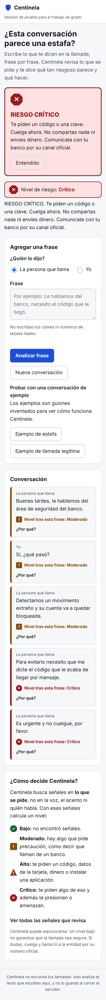

# Centinela

Prototipo de alertas de posible fraude conversacional en llamadas simuladas en español. Es el desarrollo práctico del trabajo de grado *Centinela: alertas de fraude conversacional*, Ingeniería de Sistemas y Computación, Universidad Católica de Colombia.

El prototipo recibe el audio de una llamada controlada, lo transcribe por fragmentos y compara dos estrategias de alerta sobre el mismo diálogo:

- **Por fragmento:** decide con lo dicho en la intervención actual.
- **Acumulación de indicios:** suma señales de las últimas intervenciones antes de avisar.

Ambas decisiones quedan registradas. La interfaz muestra solo el aviso de la estrategia elegida para la demostración, y una vez mostrado no se repite.

> Centinela identifica solicitudes de riesgo según una guía de anotación. No afirma que una persona haya cometido un delito.

## Herramientas (todas gratuitas)

| Parte | Herramienta |
|---|---|
| Transcripción | [faster-whisper](https://github.com/SYSTRAN/faster-whisper) en CPU |
| Clasificador | scikit-learn (TF-IDF + regresión logística), BETO opcional |
| Voces sintéticas | [Piper TTS](https://github.com/rhasspy/piper) |
| Llamada simulada | WebRTC entre dos navegadores |
| Backend | FastAPI |

## Estructura

```
backend/
  app/
    main.py            API: llamadas, fragmentos y decisiones
    cuentas.py         registro con passkey o PIN, sesiones y permisos
    db.py              base de datos SQLite local
    historial.py       historial con retención, exportar y borrar
    config.py          nivel de alerta, límite de contexto, estrategia visible
    senales.py         catálogo de señales y niveles de riesgo
    modelos.py         llamada, fragmento y decisión
    estrategias/       por_fragmento.py y acumulacion.py
    transcripcion/     faster-whisper
  tests/
datos/guiones/         guiones de llamadas simuladas (legítimas y de riesgo)
docs/                  requisitos, diagramas y guía de anotación
frontend/              interfaz web (HTML, CSS y JavaScript sin dependencias)
notebooks/             entrenamiento y análisis
```

## Cómo correrlo

Requiere Python 3.11 o superior.

```bash
python -m venv .venv
source .venv/bin/activate        # En Windows: .venv\Scripts\activate
pip install -r requirements.txt

cd backend
uvicorn app.main:app --reload
```

Abre http://localhost:8000/ para usar la interfaz, o http://localhost:8000/docs para probar la API directamente. Usa `localhost` y no `127.0.0.1`: las passkeys solo funcionan en el dominio configurado ([docs/registro.md](docs/registro.md)).



Para las pruebas:

```bash
cd backend
pytest
```

Las dependencias de voz y clasificación pesan más y se instalan aparte. Hacen falta para analizar audio ([docs/transcripcion.md](docs/transcripcion.md)):

```bash
pip install -r requirements-ml.txt
```

## Configuración

Se cambia con variables de entorno o un archivo `.env` en `backend/`:

| Variable | Por defecto | Uso |
|---|---|---|
| `CENTINELA_NIVEL_ALERTA` | `alto` | Nivel desde el que alertan ambas estrategias (`moderado`, `alto` o `critico`) |
| `CENTINELA_LIMITE_CONTEXTO` | `5` | Fragmentos que recuerda la acumulación |
| `CENTINELA_ESTRATEGIA_VISIBLE` | `acumulacion` | Estrategia cuyo aviso se muestra |
| `CENTINELA_MODELO_WHISPER` | `base` | Tamaño del modelo de transcripción |
| `CENTINELA_VOZ_PIPER` | vacío | Ruta a una voz `.onnx` de Piper; vacío usa la voz del navegador |
| `CENTINELA_BASE_DATOS` | `centinela.db` | Archivo SQLite con cuentas, sesiones y permisos |
| `CENTINELA_RP_ID` | `localhost` | Dominio para las passkeys |
| `CENTINELA_ORIGEN` | `http://localhost:8000` | Dirección exacta desde donde se abre la interfaz |
| `CENTINELA_COOKIE_SEGURA` | `false` | Ponlo en `true` cuando sirvas la interfaz por HTTPS |
| `CENTINELA_DURACION_SESION_HORAS` | `12` | Horas que dura una sesión (de 1 a 168) |
| `CENTINELA_DIAS_RETENCION` | `30` | Días que se conserva el historial antes de borrarse solo (de 1 a 365) |

## Documentación

El alcance, las amenazas y el orden de trabajo están en [docs/](docs/README.md), empezando por la [viabilidad técnica](docs/viabilidad.md).

## Estado

Avance por pasos según la [hoja de ruta](docs/hoja-de-ruta.md). El motor de señales está descrito en [docs/motor-de-senales.md](docs/motor-de-senales.md); el clasificador entrenado lo complementará en el paso 11.
