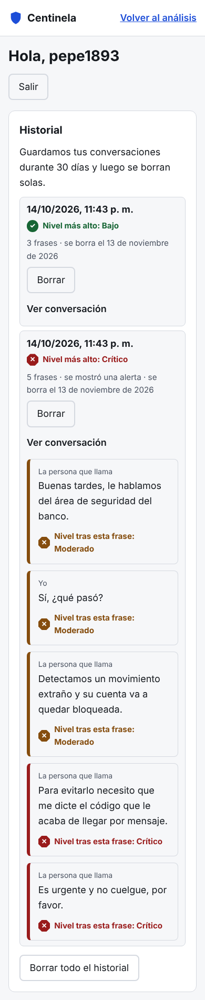

# Historial y datos personales

Paso 7 de la [hoja de ruta](hoja-de-ruta.md). Centinela guarda una conversación solo si se cumplen las dos condiciones:

1. La persona entró a su [cuenta](registro.md).
2. Activó el permiso **Guardar el historial de mis conversaciones y alertas**, que empieza apagado.

Sin eso, la conversación vive solo en la memoria del servidor mientras está abierta, como antes. La página principal dice en cada conversación si se está guardando o no.

## Qué se guarda

Por cada conversación: fecha, nivel más alto alcanzado, si se mostró la alerta y cada frase con su hablante, sus tiempos y las decisiones de las dos estrategias. El audio nunca se guarda: solo el texto que salió de la transcripción.

Todo queda en el archivo SQLite local (`CENTINELA_BASE_DATOS`), en el mismo equipo donde corre el servidor.

## Cuánto tiempo

Cada conversación se borra sola cuando pasan `CENTINELA_DIAS_RETENCION` días (30 por defecto) desde su última frase. La limpieza corre cada vez que se crea una conversación, se consulta el historial o se exportan los datos. Además, cada persona conserva como máximo 500 conversaciones; al pasar ese número se borran las más viejas. La pantalla muestra la fecha en que se borrará cada una.

## Borrar

| Acción | Qué borra |
|---|---|
| "Borrar" en una conversación | Esa conversación y sus frases. Si sigue abierta en la página principal, deja de guardarse |
| "Borrar todo el historial" (pide confirmar en pantalla) | Todas las conversaciones guardadas |
| Retirar el permiso de guardar | Todo el historial, de inmediato, y las conversaciones nuevas ya no se guardan |
| Eliminar la cuenta (pide el PIN) | Cuenta, sesiones, passkeys, permisos e historial |

El borrado es real: las filas se eliminan de SQLite en cascada, no se marcan como ocultas.

## Exportar

"Descargar mis datos" baja `centinela-mis-datos.json` con la cuenta, los permisos y su fecha, los nombres de las passkeys, las sesiones abiertas y el historial completo. El PIN, los tokens y las claves de las passkeys no se exportan porque el servidor solo guarda su hash o su parte pública. Responde al derecho de acceso de la Ley 1581 de 2012.

## Quién puede ver una conversación

Una conversación guardada tiene dueño. Cualquier otra persona, con o sin cuenta, recibe 404 al consultarla, agregarle frases, preguntarle al asistente sobre ella o borrarla, aunque conozca su identificador (modelo de amenazas, A7). Las conversaciones sin cuenta siguen funcionando como antes, protegidas por un identificador aleatorio.

## API

| Método y ruta | Uso |
|---|---|
| `GET /historial` | Lista de conversaciones con su resumen y los días de retención |
| `GET /historial/{id}` | Conversación con todas sus frases |
| `DELETE /historial/{id}` | Borra una conversación |
| `DELETE /historial` | Borra todo el historial |
| `GET /cuenta/exportar` | Descarga todos los datos en JSON |

Los borrados exigen la cabecera `X-Centinela: 1`, igual que el resto de acciones de la cuenta.

## Cómo se probó

- `backend/tests/test_historial.py`: no se guarda sin cuenta ni sin permiso; nivel máximo y frases guardadas; aislamiento entre personas y frente a anónimos; borrar una, todas y al retirar el permiso; retención vencida; exportación sin secretos; borrado en cascada al eliminar la cuenta; logs sin texto.
- En Chromium: crear cuenta, activar el permiso, analizar los dos ejemplos, ver la conversación guardada, descargar los datos, borrar una conversación, borrar todo y retirar el permiso.

## Límites

- El historial guarda el texto de las frases sin cifrar dentro de SQLite. Para la beta en un portátil el riesgo se acepta (sección 5 del [modelo de amenazas](modelo-amenazas.md)); en un servidor real habría que cifrar el disco o la base.
- Las conversaciones del historial se pueden ver, pero no retomar para seguir agregando frases después de reiniciar el servidor.
