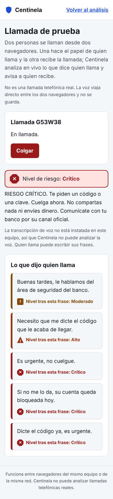

# Llamada simulada por WebRTC

Paso 9 de la [hoja de ruta](hoja-de-ruta.md). Como ninguna app puede acceder al audio de una llamada telefónica real ([viabilidad.md](viabilidad.md)), la beta simula la llamada entre dos navegadores: una persona actúa el guion de quien llama y otra recibe la llamada con Centinela activo.



## Cómo usarla

1. Quien recibe abre `http://localhost:8000/llamada.html`, marca el consentimiento y pulsa **Crear llamada**. Aparece un código de 6 caracteres (sin 0, O, 1, I ni L para dictarlo sin errores).
2. Quien llama abre la misma página en otro navegador, escribe el código, marca el consentimiento y pulsa **Unirme**. Si su papel ya está ocupado, toma el que queda.
3. Al conectarse se oyen por el micrófono. Quien llama también puede **escribir** sus frases; esto sirve para repetir un guion exacto o para probar sin el modelo de transcripción.
4. Quien recibe ve el nivel de riesgo tras cada frase y **un solo aviso** por llamada, aunque el riesgo siga subiendo. Quien llama no ve las alertas.
5. Cualquiera puede colgar; la otra persona se entera y la sala desaparece.

## Cómo funciona

```
Navegador A (llama) <── audio WebRTC directo ──> Navegador B (recibe)
        \                                         /     \
         '── señalización (WebSocket /salas) ──'       '── POST /llamadas/{id}/audio y /fragmentos
```

- **Señalización:** el servidor presenta a los dos participantes y reenvía solo cuatro tipos de mensaje: oferta, respuesta, candidatos de conexión y frases escritas. El audio nunca pasa por el servidor de señalización.
- **Sin servidores externos:** no se usan servidores STUN ni TURN de terceros, así que la llamada funciona entre navegadores del mismo equipo o de la misma red, sin costo.
- **Análisis:** el navegador de quien recibe graba la voz que le llega por trozos de 6 segundos y envía cada trozo a la [transcripción local](transcripcion.md); el texto de cada trozo pasa por el [motor de señales](motor-de-senales.md). Las frases escritas van directo al motor. Si quien recibe entró a su cuenta y lo permitió, la conversación queda en su [historial](historial.md).
- **Un solo aviso:** lo garantiza el servidor con la marca `aviso_visible` de la llamada, igual que en la página principal.

Si el modelo de transcripción no está instalado, el servidor responde 503 al primer trozo; la página deja de grabar, lo explica y la llamada sigue en modo texto.

## Seguridad y privacidad

| Medida | Detalle |
|---|---|
| Consentimiento de ambos | El primer mensaje de cada participante debe confirmar el consentimiento; sin él, el servidor cierra la conexión |
| Nada se guarda | Las salas viven en memoria y se borran al colgar o a las 2 horas; el audio se transcribe en memoria y se descarta |
| Origen verificado | El WebSocket se rechaza si lo abre una página de otro sitio |
| Límites | 100 salas a la vez, 2 personas por sala, 64 KB por mensaje y 600 mensajes por minuto |
| Logs | Solo eventos ("sala creada", "participante salió"), sin códigos ni contenido |

## Cómo se probó

- `backend/tests/test_senalizacion.py`: crear y consultar salas, reenvío entre los dos participantes, tipos desconocidos descartados, consentimiento obligatorio, papel ocupado o inválido, otro origen, mensaje demasiado grande, sala que desaparece y límite de salas.
- En Chromium con micrófonos simulados, dos navegadores separados: la conexión WebRTC llega a "En llamada" con audio remoto, el primer trozo de audio recibe 503 y la página pasa a modo texto, un guion de estafa sube de moderado a crítico con un único aviso que no reaparece, y al colgar la otra persona se entera y la sala se borra.

## Límites

- Entre dos computadores de la misma red, el micrófono solo funciona si la página se abre por HTTPS o en `localhost`; por `http://192.168…` el navegador lo bloquea y queda el modo texto.
- Entre redes distintas haría falta un servidor STUN o TURN, que la beta no usa.
- La transcripción por trozos de 6 segundos puede cortar una palabra en dos y agrega unos segundos de retraso al aviso. El paso 10 mide ese tiempo de aviso.
