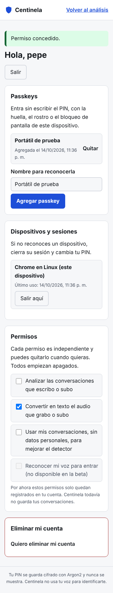

# Registro seguro

Paso 6 de la [hoja de ruta](hoja-de-ruta.md). La cuenta es opcional: analizar una conversación no la necesita. Sirve para guardar permisos, controlar las sesiones abiertas y, si se permite, conservar el [historial](historial.md).

## Qué datos pide

Solo un **alias** (3 a 30 caracteres) y un **PIN** (6 a 12 números). No se pide nombre, correo ni teléfono. El alias no distingue mayúsculas: `Ana` y `ana` son la misma cuenta.

## Formas de entrar

| Forma | Cómo funciona | Protección |
|---|---|---|
| Passkey (preferida) | El navegador firma un reto con una clave guardada en el dispositivo, desbloqueada con huella, rostro o bloqueo de pantalla | La clave privada nunca sale del dispositivo; el servidor guarda solo la clave pública. Cada reto dura 5 minutos y se borra al usarse |
| PIN | Se compara con el hash Argon2id guardado | 5 fallos bloquean la cuenta 15 minutos; se rechazan PIN triviales (111111, 123456, 987654...) |

Si el alias no existe, el servidor igual calcula un hash de relleno y responde el mismo error que con un PIN errado, para no revelar qué alias existen. El registro sí avisa si un alias está ocupado; el límite de 20 intentos por minuto por IP frena que se use para adivinar alias en masa.

Las passkeys necesitan que la interfaz se abra exactamente en el origen configurado (`http://localhost:8000` por defecto) o por HTTPS. Desde `127.0.0.1` el navegador las rechaza.

## Sesiones

- Al entrar se crea un token aleatorio de 256 bits. El navegador lo guarda en la cookie `centinela_sesion` (`HttpOnly`, `SameSite=Strict`, `Secure` cuando `CENTINELA_COOKIE_SEGURA=true`) y el servidor guarda solo su hash SHA-256.
- Duran 12 horas (`CENTINELA_DURACION_SESION_HORAS`). Cada usuario conserva como máximo 20.
- "Dispositivos y sesiones" lista cada sesión con su navegador y último uso; se puede cerrar una o todas las demás. Salir borra la sesión en el servidor, no solo la cookie.

## Defensa contra solicitudes falsificadas

Toda solicitud que cambia algo debe traer la cabecera `X-Centinela: 1`. Un formulario o enlace de otro sitio no puede añadirla, y la cookie `SameSite=Strict` no viaja desde otros sitios. Sin la cabecera la API responde 403.

## Permisos

Cada finalidad se acepta o retira por separado y todas empiezan apagadas:

| Finalidad | Estado en la beta |
|---|---|
| Guardar el historial de mis conversaciones y alertas | Activo: ver [historial.md](historial.md). Retirarlo borra lo guardado |
| Analizar las conversaciones que escribo o subo | Se registra; el análisis sin cuenta sigue disponible |
| Convertir en texto el audio que grabo o subo | Se registra; la pantalla de audio sigue pidiendo su propio consentimiento cada vez |
| Usar mis conversaciones, sin datos personales, para mejorar el detector | Se registra; se aplicará en los pasos 10 y 11 |
| Reconocer mi voz para entrar | **No disponible.** La API rechaza activarla (422) porque la autenticación vocal no existe en la beta |

## Acciones que piden el PIN

Quitar una passkey y eliminar la cuenta piden el PIN en pantalla, con el mismo límite de intentos. El asistente por voz nunca las ejecuta. Eliminar la cuenta borra en cascada sesiones, passkeys, permisos, retos pendientes e historial.

## API

| Método y ruta | Uso |
|---|---|
| `POST /cuenta/registro` | Crea la cuenta y abre sesión |
| `POST /cuenta/entrar` | Entra con alias y PIN |
| `POST /cuenta/passkey/opciones-entrada` y `POST /cuenta/passkey/entrar` | Entra con passkey |
| `POST /cuenta/salir` | Cierra la sesión actual |
| `GET /cuenta` | Alias, passkeys y permisos |
| `GET /cuenta/sesiones`, `DELETE /cuenta/sesiones/{id}`, `POST /cuenta/sesiones/cerrar-otras` | Sesiones |
| `PUT /cuenta/consentimientos` | Acepta o retira un permiso |
| `POST /cuenta/passkeys/opciones` y `POST /cuenta/passkeys` | Agrega una passkey |
| `POST /cuenta/passkeys/{id}/eliminar` | Quita una passkey (pide PIN) |
| `POST /cuenta/eliminar` | Elimina la cuenta (pide PIN) |

## Logs

Solo se registran identificadores internos y eventos (`cuenta=... entrada metodo=pin`). Nunca el alias, el PIN, el token ni las claves.

## Cómo se probó

- `backend/tests/test_cuentas.py`: cookie con sus banderas, PIN y token no guardados en claro, PIN débiles, bloqueo tras 5 fallos, límite por IP, mismo error para alias inexistente y PIN errado, revocación de sesiones, aislamiento entre usuarios, permisos, borrado en cascada, retos de un solo uso y logs sin datos.
- En Chromium con un autenticador virtual (WebAuthn de DevTools): crear cuenta, agregar passkey, salir, entrar con la passkey, cerrar la sesión de otro navegador, quitar la passkey con PIN errado y correcto, y eliminar la cuenta.

## Límites

- El límite por IP vive en memoria y se reinicia con el servidor; basta para un portátil, no para varios servidores.
- No hay recuperación de cuenta: si se olvida el PIN y no hay passkey, hay que crear otra cuenta. Es intencional, porque no se piden datos de contacto.
- Todavía no se puede cambiar el PIN.
