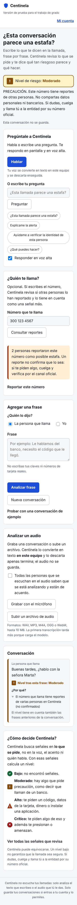

# Reporte de números

Paso 8 de la [hoja de ruta](hoja-de-ruta.md). Quien recibe una llamada puede escribir el número que lo llama, consultar si otras personas lo reportaron y reportarlo si intentaron estafarlo.

## Reglas

| Regla | Por qué (modelo de amenazas) |
|---|---|
| Reportar exige cuenta; consultar no | Frena reportes falsos en masa sin impedir que cualquiera se proteja (A15) |
| Cada cuenta reporta un número una sola vez, en cualquier formato | `300 123 4567`, `+57 300-123-4567` y `3001234567` son el mismo número (A15) |
| Máximo 10 reportes por cuenta al día | Limita a quien quiera perjudicar a muchos números (A15) |
| Solo cuentan los reportes de los últimos 180 días | Los números cambian de dueño |
| La consulta dice cuántas personas reportaron, nunca quiénes | Reportes seudónimos (A16) |
| "Reportado" no es "confirmado" | El texto siempre aclara que un reporte no confirma la estafa (A15) |
| Consultar está limitado a 30 por minuto por IP | Evita recorrer números en masa (A6) |

## Cómo pesa en el análisis

Si el número tiene reportes de **2 o más personas**, cada decisión suma la señal de contexto `numero_reportado` y marca `fuente: "contenido_y_reputacion"`. Por las reglas del [motor de señales](motor-de-senales.md):

- Sola, la señal deja la llamada en **moderado** y no dispara la alerta.
- Junto con otras dos señales de contexto o presión suma tres señales: **alto**.
- Con una solicitud sensible el nivel ya era alto o crítico por el contenido.

Un único reporte se muestra en la consulta, pero no cambia el análisis. Así un solo reporte falso no altera las alertas de nadie.

## Qué se guarda

| Dato | Cómo |
|---|---|
| Número | HMAC-SHA256 con una clave aleatoria guardada en la base local. Sin la clave no se puede saber qué números hay |
| Últimos 4 dígitos | Para que quien reportó reconozca su reporte en "Mi cuenta" |
| Motivo | Una de seis categorías cerradas, sin texto libre |
| Autor | El identificador interno de la cuenta, que nunca sale en la consulta |

La llamada en memoria guarda solo cuántas personas reportaron el número, no el número. La consulta usa `POST` para que el número no quede en los registros de acceso del servidor, y los logs registran solo identificadores y categorías.

Quien reportó puede ver sus reportes y retirarlos en "Mi cuenta". Eliminar la cuenta retira todos sus reportes, y la exportación de datos los incluye con sus últimos 4 dígitos.

## API

| Método y ruta | Uso |
|---|---|
| `GET /reportes/categorias` | Motivos posibles |
| `POST /numeros/consulta` | Cuántas personas reportaron un número y qué significa |
| `POST /reportes` | Reporta un número (cuenta y cabecera `X-Centinela`) |
| `GET /reportes/mios` | Reportes propios |
| `DELETE /reportes/{id}` | Retira un reporte propio |
| `POST /llamadas` con `{"numero": "..."}` | Empieza una conversación que tiene en cuenta la reputación del número |

## Cómo se probó

- `backend/tests/test_reportes.py`: normalización de formatos, números inválidos, cuenta y cabecera obligatorias, un reporte por número, límite diario, consulta sin autores, número no guardado en claro (ni en un volcado de la base), retirar reportes, borrado al eliminar la cuenta, exportación, la señal que nunca decide sola y logs sin el número.
- En Chromium: reportar sin cuenta, tres personas que reportan el mismo número en formatos distintos, reporte repetido, retirar un reporte y una conversación con el número reportado que queda en moderado con la razón visible.

## Límites

- No hay verificación de que quien reporta recibió de verdad la llamada; la beta no puede leer el registro de llamadas del celular ([viabilidad.md](viabilidad.md)).
- Varias cuentas creadas por la misma persona pueden sumar reportes. El límite por IP en el registro lo dificulta, pero no lo impide.
- No existe el estado "confirmado": haría falta que una entidad verifique el número, algo fuera del alcance de la beta.
